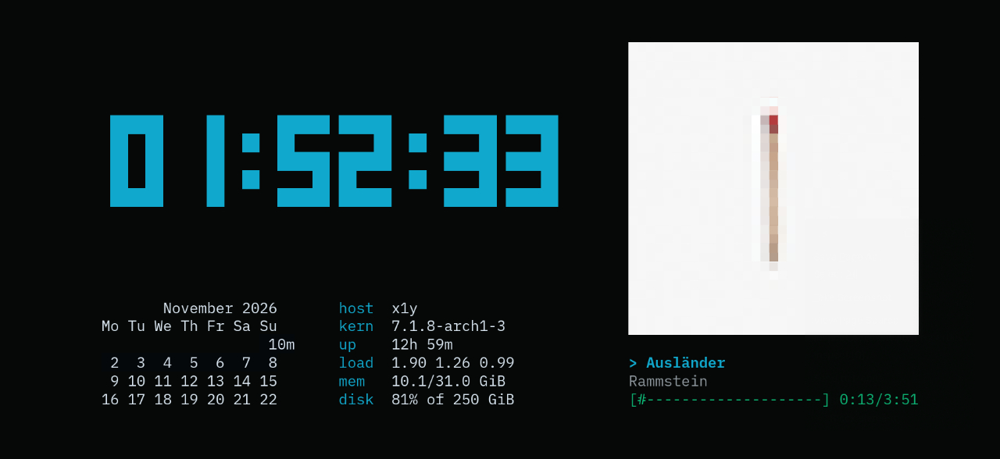

<p align="center">
  
</p>

<h1 align="center">Ansiko</h1>

<p align="center">
  <strong>Turn an old Android phone into a glass terminal for your Linux machine.</strong><br>
  No keyboard. No logic. No state. Just pixels, streamed as ANSI.
</p>

<p align="center">
  <a href="README.ru.md">Русский</a> ·
  <a href="#quick-start">Quick start</a> ·
  <a href="#widgets">Widgets</a> ·
  <a href="docs/">Docs</a>
</p>

<p align="center">
  
</p>

---

That drawer with three dead phones finally has a purpose. Put one on a stand, point it
at your desk, and let it show whatever your computer is doing: a real shell, a
`fastfetch`, an aquarium, or a wall of widgets that updates itself.

The phone app is deliberately stupid. It opens a WebSocket, reports its grid size, and
draws the bytes that arrive. Everything else — PTYs, layouts, widget scheduling,
rendering — lives in a single Python daemon on the computer.

## Two modes, one data path

**Terminal mode** runs a real PTY at the phone's exact size and mirrors it:

```sh
ansiko run fastfetch
ansiko run asciiquarium
ansiko run tty-clock -c
```

Type on the computer, watch it appear on the phone, `exit` when you are done.

**Board mode** composes a grid of widgets into a single frame and streams it through the
same channel:

- clock, calendar, system stats, now playing;
- exchange rates, countdowns, build status, weather;
- anything a script can print.

The phone does not know which mode it is in. It never sends a keystroke.

## How it works

```
  Web editor / CLI            (on your computer)
         │  HTTP + WebSocket
         ▼
  ansiko daemon               PTY · layouts · widget scheduler · board frames
         │  WebSocket: raw ANSI bytes
         ▼
  Android app                 read-only terminal view · screen always on
```

The phone reports `cols × rows` once, and the daemon builds the PTY or the board at
exactly that size. Resize the window or rotate the screen and it re-lays out.

## Quick start

**1. Server** — Python 3.11+ on Linux:

```sh
uv tool install ./server          # or: pipx install ./server
cp ansiko.example.toml ansiko.local.toml
$EDITOR ansiko.local.toml         # set a long token and your LAN address
ansiko serve --host 192.168.1.103
```

**2. Phone** — install the APK from [Releases](../../releases), or build it:

```sh
cd android
./gradlew assembleDebug
adb install -r app/build/outputs/apk/debug/app-debug.apk
```

**3. Pair** — open `http://192.168.1.103:8765/` on the computer, log in with the token,
then in the app long-press the screen and hit **Scan pairing QR**. Or type the host,
port and token by hand in the settings screen.

**4. Push something:**

```sh
ansiko run asciiquarium
ansiko push desk
ansiko status
```

## Web dashboard

Everything is driven from the browser at `http://<host>:<port>/` — no TUI, no build step.

| | |
|---|---|
| **Board library** | every board in `boards/`, with a live ANSI preview and one-click push |
| **Visual editor** | drag, eight resize handles, 5% snapping, collision checks, undo/redo, keyboard nudge |
| **Presets** | automatic packing, equal columns, grid, vertical stack |
| **Raw TOML** | edit the board source with line/column validation |
| **Widget catalog** | sizes, intervals, timeouts, single test run |
| **Live monitor** | the exact byte stream the phone receives, with a full-screen mode |
| **Pairing** | a QR code containing host, port and token |

The interface is English and Russian, dark-only, and uses self-hosted Archivo + IBM Plex
Mono, so it works with no internet access.

## Widgets

A widget is a directory with a manifest and any executable. Python, shell, Node, Go, a
compiled binary — the daemon only reads stdout.

```
widgets/clock/
├── widget.toml
└── run.py
```

```toml
# widget.toml
name        = "clock"
description = "Local time"
command     = "./run.py"
interval    = 1      # seconds between runs
width       = 20     # suggested size in cells
height      = 5
timeout     = 5      # kill the script after N seconds
```

```python
#!/usr/bin/env python3
import time
print(time.strftime("%H:%M:%S"))
```

The script gets its allotted size in `ANSIKO_COLS` and `ANSIKO_ROWS`. If it crashes or
times out, only its own cell shows an error — the rest of the board keeps running.

Bundled examples: `banner`, `calendar`, `clock`, `date`, `music`, `music-art`,
`sysinfo`, `ttyclock`, `weather`. Put your own in `custom-widgets/` (ignored by git); a
custom widget with the same name overrides the bundled one.

> Tip: `figlet`, `toilet`, `rich` and `plotext` make excellent widget output — big
> digits, boxes and charts.

## Boards

A board is a directory under `boards/` or `custom-boards/` with a `board.toml`. The
simplest form lets the server pack widgets for you:

```toml
name = "Desk"
frame = true
widgets = ["clock", "calendar", "sysinfo"]
```

For a fixed composition, place cells with fractional coordinates — they survive rotation
and different screen sizes:

```toml
name = "Desk"
frame = true

[[cells]]
widget = "clock"
x = 0.0
y = 0.0
width = 0.55
height = 0.3

[[cells]]
widget = "calendar"
x = 0.55
y = 0.0
width = 0.45
height = 0.62
```

`frame = true` asks the server to draw a titled box around each cell and subtract the
border from the widget's area. Bundled boards: `desk`, `demo`, `focus`, `minimal`.

Put your own boards in `custom-boards/` (ignored by git). A custom board with the same
folder name overrides the bundled one, new boards from the dashboard are created there,
and editing a bundled board writes a local override instead of modifying `boards/`.

## Built for a screen that never sleeps

The phone is meant to hang on a wall for weeks, so the client takes care of the panel:

- **Pixel shift** — the whole grid drifts around a small ring every minute, so no glyph
  stays in the same physical pixel forever.
- **Night dimming** — between 22:00 and 08:00 the screen drops to a chosen brightness
  (20–100 %), then returns to normal in the morning.
- **Immersive, always-on display** — no system bars, no lock screen, no accidental input.

Both burn-in options live in the settings screen and can be turned off.

## CLI

```
ansiko serve              start the daemon
ansiko run <command...>   run a program on the phone until exit / Ctrl+C
ansiko push <board>       switch the phone to a saved board
ansiko status             show the connected device and current mode
```

## Security

This is effectively a remote shell on your network, so:

- a token is always required — a long random one, not a PIN;
- bind to your LAN interface, never to the public internet;
- keep secrets in `ansiko.local.toml`, which is ignored by git;
- if you need access from outside, put it behind Tailscale or WireGuard.

## Documentation

- [Widget guide](docs/widgets.md) — manifest, environment, ANSI, errors, testing.
- [Board format](docs/boards.md) — auto and free layouts, frames, the visual editor.
- [Web dashboard](docs/web-ui.md) — library, editor, monitor, widgets, pairing, shortcuts.
- [Protocol](docs/protocol.md) — display, session and preview WebSockets; HTTP API.

## Status

- [x] Daemon: WebSocket + PTY, a live shell on the phone
- [x] Android client: read-only terminal, auto-reconnect, keep screen on
- [x] Terminal mode (`ansiko run`)
- [x] Board mode: auto packing, fractional cells, frames, scheduler
- [x] Web UI: token login, board editor, push, QR pairing
- [x] Visual editor: drag, resize, snapping, presets, undo/redo, live preview
- [x] Widget catalog, bundled examples and documentation
- [x] OLED burn-in protection: pixel shift and night dimming
- [ ] Page rotation and tap zones
- [ ] Configurable widgets
- [ ] Several devices support

## Contributing

Widgets are the easiest way in: drop a directory under `widgets/` with a manifest and a
script, keep it small and dependency-free, and test it with `ANSIKO_COLS` and
`ANSIKO_ROWS` set. Read the [widget guide](docs/widgets.md) first.

## License

GPL-3.0-or-later.
