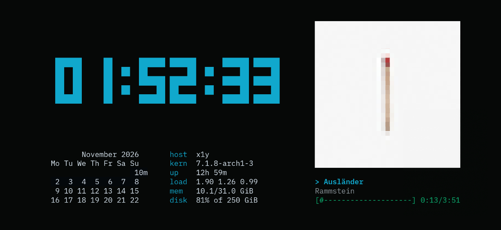

<p align="center">
  
</p>

<h1 align="center">Ansiko</h1>

<p align="center">
  <strong>Превращает старый Android-телефон в стеклянный терминал для вашей Linux-машины.</strong><br>
  Без клавиатуры. Без логики. Без состояния. Только пиксели, которые приходят как ANSI.
</p>

<p align="center">
  <a href="README.md">English</a> ·
  <a href="#быстрый-старт">Быстрый старт</a> ·
  <a href="#виджеты">Виджеты</a> ·
  <a href="docs/">Документация</a>
</p>

<p align="center">
  
</p>

---

Ящик с тремя мёртвыми телефонами наконец-то пригодился. Поставьте один на подставку,
разверните к столу — и пусть показывает, чем занят компьютер: настоящий shell,
`fastfetch`, аквариум или стену виджетов, которая обновляется сама.

Приложение на телефоне намеренно глупое. Оно открывает WebSocket, сообщает размер
сетки и рисует пришедшие байты. Всё остальное — PTY, раскладки, расписание виджетов,
рендеринг — живёт в одном демоне на Python на компьютере.

## Два режима, один поток данных

**Режим терминала** запускает настоящий PTY ровно под размер экрана телефона и зеркалит его:

```sh
ansiko run fastfetch
ansiko run asciiquarium
ansiko run tty-clock -c
```

Печатаете на компьютере, смотрите на телефон, выходите через `exit`.

**Режим доски** собирает сетку виджетов в один кадр и отдаёт его по тому же каналу:

- часы, календарь, состояние системы, текущий трек;
- курсы валют, счётчики до события, статус сборки, погода;
- всё, что умеет напечатать скрипт.

Телефон не знает, в каком он режиме. Он никогда не отправляет нажатий клавиш.

## Как это устроено

```
  Веб-редактор / CLI          (на вашем компьютере)
         │  HTTP + WebSocket
         ▼
  демон ansiko                PTY · раскладки · планировщик виджетов · кадры доски
         │  WebSocket: сырые ANSI-байты
         ▼
  приложение на Android       терминал только для чтения · экран всегда включён
```

Телефон один раз сообщает `cols × rows`, и демон создаёт PTY или доску ровно этого
размера. Поменяли размер окна или повернули экран — раскладка пересобирается.

## Быстрый старт

**1. Сервер** — Python 3.11+ на Linux:

```sh
uv tool install ./server          # или: pipx install ./server
cp ansiko.example.toml ansiko.local.toml
$EDITOR ansiko.local.toml         # задайте длинный токен и адрес в локальной сети
ansiko serve --host 192.168.1.103
```

**2. Телефон** — поставьте APK из [Releases](../../releases) или соберите сами:

```sh
cd android
./gradlew assembleDebug
adb install -r app/build/outputs/apk/debug/app-debug.apk
```

**3. Сопряжение** — откройте `http://192.168.1.103:8765/` на компьютере, войдите по
токену, затем на телефоне зажмите экран и нажмите **Сканировать QR**. Либо введите
хост, порт и токен вручную в настройках.

**4. Отправьте что-нибудь:**

```sh
ansiko run asciiquarium
ansiko push desk
ansiko status
```

## Веб-панель

Всё управляется из браузера на `http://<host>:<port>/` — без TUI и без сборки фронтенда.

| | |
|---|---|
| **Библиотека досок** | все доски из `boards/`, живой ANSI-превью и отправка одним нажатием |
| **Визуальный редактор** | перетаскивание, восемь ручек размера, привязка к сетке 5 %, проверка пересечений, undo/redo, сдвиг с клавиатуры |
| **Пресеты** | автоматическая упаковка, равные колонки, сетка, вертикальный стек |
| **Сырой TOML** | правка исходника доски с проверкой строки и колонки |
| **Каталог виджетов** | размеры, интервалы, таймауты, одиночный тестовый запуск |
| **Живой монитор** | ровно тот поток байт, что получает телефон, плюс полноэкранный режим |
| **Сопряжение** | QR-код с хостом, портом и токеном |

Интерфейс двуязычный (английский и русский), тёмный и со своими шрифтами Archivo и
IBM Plex Mono — работает без доступа в интернет.

## Виджеты

Виджет — это каталог с манифестом и любым исполняемым файлом. Python, shell, Node, Go,
скомпилированный бинарник — демон читает только stdout.

```
widgets/clock/
├── widget.toml
└── run.py
```

```toml
# widget.toml
name        = "clock"
description = "Местное время"
command     = "./run.py"
interval    = 1      # секунд между запусками
width       = 20     # желаемый размер в ячейках
height      = 5
timeout     = 5      # убить скрипт через N секунд
```

```python
#!/usr/bin/env python3
import time
print(time.strftime("%H:%M:%S"))
```

Скрипт получает свой размер в `ANSIKO_COLS` и `ANSIKO_ROWS`. Если он упал или не
уложился в таймаут, ошибка появится только в его ячейке — остальная доска продолжает
жить.

В комплекте: `clock`, `calendar`, `sysinfo`, `banner`. Свои кладите в
`custom-widgets/` (каталог игнорируется git); одноимённый пользовательский виджет
перекрывает встроенный.

> Совет: `figlet`, `toilet`, `rich` и `plotext` дают отличный вывод — крупные цифры,
> рамки и графики.

## Доски

Доска — это каталог в `boards/` с файлом `board.toml`. В простейшем виде сервер сам
расставит виджеты:

```toml
name = "Desk"
frame = true
widgets = ["clock", "calendar", "sysinfo"]
```

Для фиксированной композиции задайте ячейки дробными координатами — они переживают
поворот и разные размеры экрана:

```toml
name = "Desk"
frame = true

[[cells]]
widget = "clock"
x = 0.0
y = 0.0
width = 0.55
height = 0.3

[[cells]]
widget = "calendar"
x = 0.55
y = 0.0
width = 0.45
height = 0.62
```

`frame = true` просит сервер нарисовать вокруг каждой ячейки рамку с заголовком и
вычесть её из области виджета. В комплекте доски `desk`, `demo`, `focus`, `minimal`.

## Для экрана, который никогда не выключается

Телефон должен висеть на стене неделями, поэтому клиент заботится о матрице:

- **Сдвиг пикселей** — вся сетка раз в минуту смещается по небольшому кольцу, чтобы
  ни один символ не оставался в одном и том же физическом пикселе.
- **Ночное затемнение** — с 22:00 до 08:00 экран опускается до выбранной яркости
  (20–100 %), а утром возвращается к обычной.
- **Полноэкранный режим** — без системных панелей, без блокировки, без случайных нажатий.

Обе защиты от выгорания включаются и выключаются в настройках.

## CLI

```
ansiko serve              запустить демон
ansiko run <команда...>   выполнить программу на телефоне до выхода / Ctrl+C
ansiko push <доска>       переключить телефон на сохранённую доску
ansiko status             показать подключённое устройство и текущий режим
```

## Безопасность

По сути это удалённый shell в вашей сети, поэтому:

- токен обязателен — длинный случайный, а не короткий PIN;
- слушайте интерфейс локальной сети, никогда не публичный интернет;
- секреты держите в `ansiko.local.toml`, этот файл игнорируется git;
- если нужен доступ снаружи — ставьте за Tailscale или WireGuard.

## Документация

- [Руководство по виджетам](docs/widgets.md) — манифест, окружение, ANSI, ошибки, тесты.
- [Формат досок](docs/boards.md) — авто- и свободная раскладка, рамки, визуальный редактор.
- [Веб-панель](docs/web-ui.md) — библиотека, редактор, монитор, виджеты, сопряжение, горячие клавиши.
- [Протокол](docs/protocol.md) — WebSocket дисплея, сессии и превью; HTTP API.

## Статус

- [x] Демон: WebSocket + PTY, живой shell на телефоне
- [x] Android-клиент: терминал только для чтения, автопереподключение, экран всегда включён
- [x] Режим терминала (`ansiko run`)
- [x] Режим доски: автоупаковка, дробные ячейки, рамки, планировщик
- [x] Веб-интерфейс: вход по токену, редактор досок, отправка, QR-сопряжение
- [x] Визуальный редактор: перетаскивание, размеры, привязка, пресеты, undo/redo, живое превью
- [x] Каталог виджетов, примеры и документация
- [x] Защита OLED от выгорания: сдвиг пикселей и ночное затемнение
- [ ] Поворот страниц и тап-зоны
- [ ] Настройка виджетов
- [ ] Поддержка нескольких устройств

## Участие

Проще всего начать с виджета: каталог в `widgets/` с манифестом и скриптом, минимум
зависимостей, проверка с заданными `ANSIKO_COLS` и `ANSIKO_ROWS`. Сначала прочитайте
[руководство по виджетам](docs/widgets.md).

## Лицензия

Copyright (C) 2026 venterum

GPL-3.0-or-later — полный текст в [LICENSE](LICENSE).
